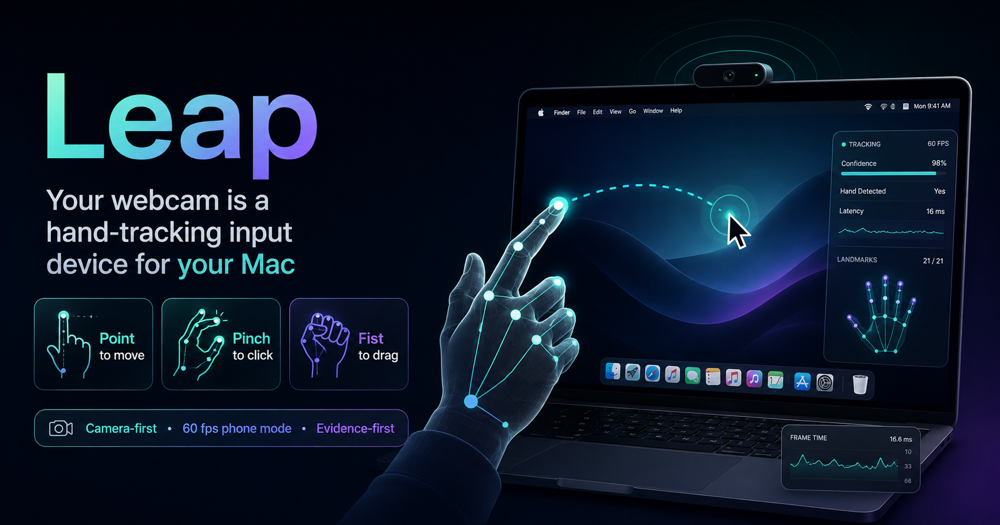

# Leap



**Five hand gestures, from your webcam, for the things a mouse cannot do while
your hands are somewhere else.** Open the mic and dictate, submit, paste, and
frame a region of the screen with both hands to capture it. No special
hardware, no setup beyond a virtualenv.

The hand deliberately does **not** drive the cursor. It used to — that was the
whole project — and all of it still works behind `--legacy`. But a mouse
points better, and every expensive bug here lived in the pointing path. What
ships is the part that earns its keep.

## The vocabulary

| Pose | Action |
|---|---|
| thumbs-up | mic on (chime); thumbs-up again = off |
| ILY on your **other** hand | Enter — submit what you dictated |
| V sign (peace) | Cmd+V |
| frame a rectangle with both hands | screenshot that region → clipboard |
| ILY on your **cursor** hand | pause / resume everything |

Hold the pose until the ring fills. The mic, Enter, paste and the pause fire
**as the ring fills**, while you still hold the pose: there is no abort window
once it is full. The frame shot is the one that fires **when you release**.
The pause takes about 1.2 s; the others under half a second. Either hand
fires the mic, the paste and the frame shot; ILY is the one pose whose meaning depends on which
hand makes it, which is what buys a pause without spending a second pose on
it. While you are composing a frame shot, nothing else can fire.

The frame lands on **the display your cursor is on**, not the main one — the
highlight and the shutter both follow it, so on a two-screen desk you frame
the screen you are looking at.

## Quick start

```bash
uv venv --python 3.12 .venv
VIRTUAL_ENV=$PWD/.venv uv pip install -e '.[dev,camera,menubar]'
curl -L --create-dirs -o vendor/hand_landmarker.task \
  "https://storage.googleapis.com/mediapipe-models/hand_landmarker/hand_landmarker/float16/latest/hand_landmarker.task"

.venv/bin/leapinput --source camera                     # dry-run
.venv/bin/leapinput --source camera --backend quartz    # for real
```

Before the real backend works:

- **macOS permissions.** Accessibility (to post keys), Camera, and Screen
  Recording (for the frame shot), granted to the app that starts the session.
  See [docs/learnings/macos-platform.md](docs/learnings/macos-platform.md#permissions-are-attributed-to-the-process-tree-and-fail-silently).
- **OBSBOT webcams need ffmpeg** (`brew install ffmpeg`); without it the
  OBSBOT is skipped and the built-in camera is used. See
  [docs/sources.md](docs/sources.md).
- **One real session at a time.** A second `--backend quartz` session exits
  with code 2.

Always on:

```bash
scripts/leapctl on                 # detached; also: off / status / log
scripts/install-menubar-app.sh     # menu bar switch, can start at login
```

`install-menubar-app.sh` needs the `menubar` extra (rumps) and stops with an
error without it. `off` means off — the session, its guard and its overlay
all go, leaving only the menu bar switch. The `.app` wrapper is not just packaging: macOS attributes
the Camera grant to the app that starts the process tree, so the bundle is what
System Settings lists and what must declare `NSCameraUsageDescription`.

## Why it holds up

- **Verified against a corpus, not a demo.** 3,639 recorded frames of real use
  replay through the pipeline in the test suite, which CI runs on macOS on
  every push ([.github/workflows/test.yml](.github/workflows/test.yml)).
  Measured 2026-11-15: 376 hardware-free tests pass and 3 skip, in about
  12 seconds.
- **Arguments are settled with data.** Every threshold was fitted from
  recorded hand data, and every fix this month was pinned by a test that fails
  on the old code first. A phantom-click hunt took 352 recorded clicks to
  settle; a "the frame is jittery" report was traced to a rect being sampled
  during the Schmitt tail of a releasing finger.
- **Designed to fail safe.** Dry-run by default. A separate guard process
  releases every mouse button, and Option if the mic held it, when the main
  process dies — even to `SIGKILL`. Tracking loss, stream stalls and crashes
  all reach the same release path.

## Docs

Start at **[docs/START-HERE.md](docs/START-HERE.md)**.

| Doc | What |
|---|---|
| [docs/decisions.md](docs/decisions.md) | Why the tool is shaped like this. What moved, the evidence, **how to bring it back** |
| [docs/learnings/](docs/learnings/) | The durable knowledge, by subject — including everything now shelved |
| [docs/vocabulary.md](docs/vocabulary.md) | Full gesture tables, routing rules, corpus verification |
| [docs/troubleshooting.md](docs/troubleshooting.md) | When it doesn't work; the telemetry dashboard and bench; the safety model |
| [docs/calibration.md](docs/calibration.md) | Fitting thresholds and the reach box to your hand |
| [docs/architecture.md](docs/architecture.md) | Pipeline, layer rules, module map |
| [docs/sources.md](docs/sources.md) | Webcam vs phone vs Leap Motion, and the OBSBOT/ffmpeg path |

While a session runs, a local dashboard serves at `http://127.0.0.1:8788`
(`--telemetry-port`, `--no-telemetry`); see
[docs/troubleshooting.md](docs/troubleshooting.md#live-telemetry). Runtime
state lives in `~/.leapinput/`: the session log and PID file, the pause flag,
the session lock, and the click log under `telemetry/`; see
[docs/START-HERE.md](docs/START-HERE.md#where-the-evidence-lives).
`--pane grab` turns the frame shot into a change request for an agent; see
[docs/learnings/safety-and-failure-modes.md](docs/learnings/safety-and-failure-modes.md#untrusted-content-grab-modes-rule).

## Legacy

Nothing was deleted. `--legacy` restores the full cursor-driving tool —
pointing, clicking, dragging, copy, Mission Control — along with the reach
box, PRISM precision, the accuracy bench and the phone/WebRTC source. It is
kept to be explored and built on, and the reasoning behind every shelved piece
is in [docs/decisions.md](docs/decisions.md) and
[docs/learnings/](docs/learnings/).

```bash
.venv/bin/leapinput --legacy --source camera   # the whole previous tool
scripts/leapctl on --legacy --source phone     # the 60fps phone camera; without
                                               # --legacy this exits, by design
```

Built with Python 3.12, MediaPipe Tasks + OpenCV, PyObjC/Quartz for
`CGEventPost`, and a vendored 1€ filter (Casiez, Roussel & Vogel, CHI 2012).
